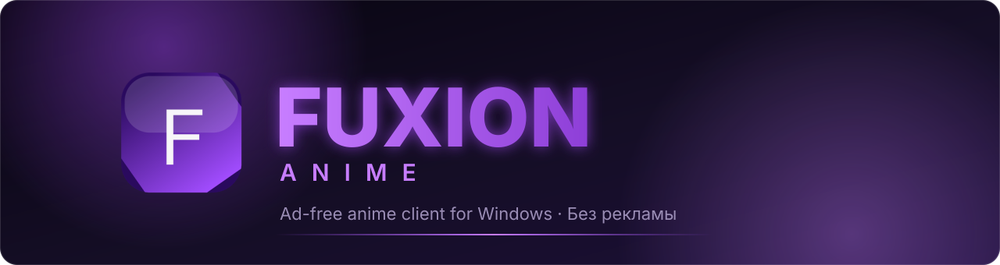

 

### A fast, beautiful, completely ad-free anime client for Windows
### Быстрый, красивый и полностью безрекламный клиент для просмотра аниме на Windows

 

 

**🌐 &nbsp;[English](#en) &nbsp;·&nbsp; [Русский](#ru)**

 

# 🇬🇧 English

> **Fuxion Anime** is a native Windows desktop app for watching anime: a rich catalog, a built-in LibVLC player, offline downloads and a real community, with **no ads** and a **fair, cosmetic-only subscription**.

> [!NOTE]
> This repository hosts **releases and documentation only**. The application is proprietary, closed-source software by **Fuxion Labs** (see [LICENSE](LICENSE)).

## ✨ Highlights

| | |
|---|---|
| 🚫 **Zero ads** | No banners, no pop-ups, no trackers, no injected video ads. |
| 💎 **Honest subscription** | Premium is **cosmetics and profile customization only**. Nothing is locked: every title, episode and quality is available to everyone. |
| 🎬 **Native player** | Built-in **LibVLC** player: quality selector, mini-player, skip intros/outros, resume where you stopped, hotkeys. |
| 📥 **Offline mode** | Background downloads of episodes (**MP4** and **HLS**) with a queue, progress and offline playback. |
| 🌍 **Two catalogs** | Separate **Russian** and **English** experiences: RU/EN interface, catalog and voice-overs by language. |
| 👥 **Real community** | Friends, private chats, threaded comments, reviews, bookmarks and profiles. |
| 🎮 **Discord Rich Presence** | Show what you are watching, with time left until the end of the episode. |
| 🔄 **Over-the-air updates** | Updates arrive inside the app: verified, silent, automatic restart. |
| 🎨 **Custom XAML themes** | Dark neon design, glass panels, animated frames, backgrounds and nickname styles. |

## 📦 Installation

1. Open the **[Releases](https://github.com/Fuxion-labs/Fuxion-Anime-Win-Public/releases)** page and pick **[v1.0.*](https://github.com/Fuxion-labs/Fuxion-Anime-Win-Public/releases/tag/v1.0.2)**, or press the **Download** button above.
2. Download **`FuxionAnime-Setup-1.0.*.exe`**.
3. Run the installer. Windows SmartScreen may say *"Windows protected your PC"* because the installer is not code-signed yet: click **More info → Run anyway**.
4. Choose your language (English / Русский) and click **Install**. No administrator rights are required: the app installs into your user profile.
5. Launch **Fuxion Anime** and sign up (e-mail code, Google, Discord or Telegram) or sign in.

> [!TIP]
> You only need to download the installer once. Later versions arrive **inside the app** (a notification with an **Update** button).

<b>Uninstall</b>

 

*Settings → Apps → Installed apps → Fuxion Anime → Uninstall.* The uninstaller asks whether to also delete app data (sign-in, settings, downloads); the default answer is **No**.

## 🖥️ System requirements

| | **Minimum** | **Recommended** |
|:--|:--|:--|
| **OS** | Windows 10, version 1809 (build 17763), 64-bit | Windows 10 22H2 / Windows 11 |
| **CPU** | 64-bit (x64) dual-core | Quad-core |
| **RAM** | 4 GB | 8 GB |
| **Disk** | ~300 MB + space for downloaded episodes | SSD |
| **Network** | Internet connection (catalog, accounts, streaming) | Broadband, 10 Mbit/s+ for 1080p |
| **Runtime** | Not required: .NET is bundled with the app | — |
| **GPU** | Not required | — |

## 🧩 Full feature list

<b>🎬 Player</b>

 

- **LibVLC** playback rendered directly into the app window: no iframes, no web player, no ads or splices.
- **Quality selector** from 360p up to 1080p (depends on the source).
- **Skip intros & outros**: a skip button and an **auto-skip** option, a **+85 s** jump, with a fallback source for timestamps when the primary one has none.
- **Mini-player** that stays on top of other windows.
- Fullscreen, timeline, auto-hiding panels, **volume** slider, mouse wheel, ↑/↓ keys and **M** to mute (the level is remembered).
- **Resume** where you stopped and **next episode** with progress synced to your account.
- **English dub & sub** with subtitles for the English catalog; downloaded episodes keep their subtitles.

<b>📥 Offline & downloads</b>

 

- Background downloads with a **queue, progress and cancel**.
- **MP4** files for direct sources and **HLS** streams (segments are downloaded in parallel, retried and merged into a single file; AES-128 supported).
- Choose your own downloads folder; a local library of downloaded episodes.
- Downloaded episodes **play from disk**, including skip markers and subtitles, with no connection required.

<b>🔎 Catalog & discovery</b>

 

- Search with filters: **genre, type, status, year, sorting**, plus curated collections and a "Show more" feed.
- **Release calendar** for the coming week, day by day.
- Rich title page: description, poster, rating, voice-overs and episodes, **related titles, similar titles and characters**.
- Smart poster fallbacks when the primary source has no image.
- **Two catalogs:** Russian and English. The English side uses English metadata and English dub/sub sources.
- Works around blocked mirrors: automatic mirror switching and your **own proxy** setting.

<b>👥 Social</b>

 

- **Friends:** requests by nickname, search, friend profiles with their bookmarks (privacy-aware).
- **Private chats** between friends with unread badges.
- **Threaded comments** for titles and individual episodes, with spoilers handled.
- **Reviews:** one per title, spoilers hidden, the author's rating shown next to it.
- **Lists & bookmarks:** watching, planned, completed and more; your own **1-10 rating** next to the community average.
- **Report** button for comments, reviews and profiles; community **moderation** and announcements banner.

<b>🎨 Customization & subscription</b>

 

- **Premium** is purely cosmetic: avatar **frames**, nickname color, built-in and **animated backgrounds**, your own background image.
- **Premium+** adds a **custom text tag** and **animated nickname styles** (RGB, neon, fire, ocean, aurora, gold).
- **Supporter** status and a **supporters leaderboard** for people who donate to the project (anonymous donations supported).
- Your style is visible everywhere: profile, comments, reviews and leaderboards.
- Pay with **crypto**; promo codes and discounts are supported.
- Premium never restricts content, quality, downloads or features of the player.

<b>🔐 Account & security</b>

 

- Sign up with **e-mail + one-time code** (protected by captcha) or sign in with **Google, Discord or Telegram**.
- **Password recovery** by e-mail, e-mail linking and **social account linking** in Settings.
- Passwords are stored hashed (**BCrypt**); the sign-in token on your PC is encrypted with **Windows DPAPI**; changing your password signs out every other device.
- Brute-force protection: captcha after failed attempts and temporary lockouts.

<b>🔌 Integrations & updates</b>

 

- **Discord Rich Presence:** title, episode, pause state and time left.
- **Over-the-air updates (OTA):** the app checks for new versions, downloads the installer, **verifies its SHA-256**, installs silently and restarts. Mandatory updates are supported.
- **Russian and English interface**, selectable in the installer and in Settings.
- A proper **Windows installer**: per-user install, Start menu and optional desktop shortcut, clean uninstall.

## 🔒 Privacy & safety

- **No ads, no third-party trackers, no analytics SDKs.**
- On install/uninstall the app sends an **anonymous counter**: a random install ID, the app version and the platform. No name, e-mail, IP-based profile or hardware identifiers.
- Account data (username, lists, comments, messages, customization) is stored on Fuxion servers **only for registered accounts**.
- Fuxion does **not host or distribute video**.

> [!IMPORTANT]
> **Content disclaimer.** Fuxion Anime is a client application. Catalog metadata is provided by third-party services such as Shikimori and AniList, and video streams are provided by third-party sources under their own terms and the laws of your country. Fuxion Labs is not affiliated with these services, nor with Discord, Telegram, Google or Reddit; all trademarks belong to their respective owners. If you are a rights holder and have a concern, contact us in our [Telegram](https://t.me/FuxionDev).

## ❓ FAQ

<b>Is Fuxion Anime free?</b>

 

Yes. The app is free to download and use. Premium, Premium+ and donations are optional and never lock content.

<b>Windows says the app is from an unknown publisher. Is it safe?</b>

 

The installer is not code-signed yet (a signing certificate is paid), so SmartScreen shows a warning for new software. Download only from this page or from <a href="https://fuxion.stream">fuxion.stream</a>, then choose *More info → Run anyway*.

<b>How do updates work?</b>

 

The app checks for a new version on start and every few hours. When one is available, a banner with an **Update** button appears. The installer is downloaded, verified (SHA-256) and installed silently; the app restarts by itself.

<b>Where are my data and downloads?</b>

 

App data lives in <code>%LOCALAPPDATA%\Fuxion</code>. Downloads go to the folder you choose in *Settings → Downloads*.

<b>Will there be an Android version?</b>

 

Yes, it is in development. News will be posted on the website and in our community.

## 🧱 Built with

**C# / .NET 10** · **Avalonia UI 12** (MVVM) · **LibVLCSharp** · Refit · Serilog · Inno Setup

## 💬 Community

## 📄 License

**All Rights Reserved.** Free to download and use personally from the official sources; redistribution, modification, reverse engineering and commercial use are prohibited. Full text: [LICENSE](LICENSE).

<a href="#readme">⬆ Back to top</a> &nbsp;·&nbsp; <a href="#ru">Русский ⬇</a>

 
 

---

 

# 🇷🇺 Русский

> **Fuxion Anime** — нативное приложение для Windows для просмотра аниме: большой каталог, встроенный плеер на LibVLC, скачивание серий и настоящее сообщество. **Без рекламы** и с **честной подпиской, которая даёт только косметику**.

> [!NOTE]
> В этом репозитории лежат **только релизы и документация**. Приложение — проприетарное ПО с закрытым исходным кодом, правообладатель **Fuxion Labs** (см. [LICENSE](LICENSE)).

## ✨ Главное

| | |
|---|---|
| 🚫 **Ноль рекламы** | Никаких баннеров, всплывающих окон, трекеров и рекламы в видео. |
| 💎 **Честная подписка** | Premium — **только косметика и кастомизация профиля**. Контент не закрыт: все тайтлы, серии и качество доступны всем. |
| 🎬 **Нативный плеер** | Встроенный плеер на **LibVLC**: выбор качества, мини-плеер, пропуск заставок, продолжение с места остановки, горячие клавиши. |
| 📥 **Офлайн-режим** | Фоновая загрузка серий (**MP4** и **HLS**) с очередью, прогрессом и просмотром без интернета. |
| 🌍 **Два каталога** | Отдельный **русский** и **английский** опыт: интерфейс, каталог и озвучки по языку. |
| 👥 **Живое сообщество** | Друзья, личные чаты, ветвистые комментарии, отзывы, закладки и профили. |
| 🎮 **Discord Rich Presence** | Показывайте, что смотрите, со временем до конца серии. |
| 🔄 **Обновления «по воздуху»** | Новые версии приходят прямо в приложение: проверка, тихая установка, автоперезапуск. |
| 🎨 **Свои XAML-темы** | Тёмный неоновый дизайн, стеклянные панели, анимированные рамки, фоны и стили ников. |

## 📦 Установка

1. Откройте страницу **[Releases](https://github.com/Fuxion-labs/Fuxion-Anime-Win-Public/releases)** и выберите **[v1.0.*](https://github.com/Fuxion-labs/Fuxion-Anime-Win-Public/releases/tag/v1.0.2)**, либо нажмите кнопку **Download** выше.
2. Скачайте **`FuxionAnime-Setup-1.0.*.exe`**.
3. Запустите установщик. Windows SmartScreen может показать «Система Windows защитила ваш компьютер»: установщик пока не подписан цифровой подписью. Нажмите **Подробнее → Выполнить в любом случае**.
4. Выберите язык (English / Русский) и нажмите **Установить**. Права администратора не нужны: приложение ставится в профиль пользователя.
5. Запустите **Fuxion Anime**, зарегистрируйтесь (код на почту, Google, Discord или Telegram) или войдите.

> [!TIP]
> Установщик нужно скачать один раз. Дальше новые версии приходят **внутри приложения** (уведомление с кнопкой **Обновить**).

<b>Удаление</b>

 

*Параметры → Приложения → Установленные приложения → Fuxion Anime → Удалить.* Деинсталлятор спросит, удалять ли данные приложения (вход, настройки, загрузки); по умолчанию — **Нет**.

## 🖥️ Системные требования

| | **Минимум** | **Рекомендуется** |
|:--|:--|:--|
| **ОС** | Windows 10 версии 1809 (сборка 17763), 64-бит | Windows 10 22H2 / Windows 11 |
| **Процессор** | 64-бит (x64), 2 ядра | 4 ядра |
| **ОЗУ** | 4 ГБ | 8 ГБ |
| **Диск** | ~300 МБ + место под скачанные серии | SSD |
| **Сеть** | Подключение к интернету (каталог, аккаунт, просмотр) | Широкополосное, от 10 Мбит/с для 1080p |
| **Среда выполнения** | Не нужна: .NET входит в состав приложения | — |
| **Видеокарта** | Не требуется | — |

## 🧩 Полный список возможностей

<b>🎬 Плеер</b>

 

- Воспроизведение через **LibVLC** прямо в окне приложения: без iframe и веб-плеера, без рекламы и склеек.
- **Выбор качества** от 360p до 1080p (зависит от источника).
- **Пропуск заставок**: кнопка и **авто-пропуск**, переход **+85 с**; запасной источник таймкодов, если основного нет.
- **Мини-плеер** поверх остальных окон.
- Полный экран, таймлайн, автоскрытие панелей, **громкость**: ползунок, колесо мыши, клавиши ↑/↓ и **M** для отключения звука (уровень запоминается).
- **Продолжение** с места остановки и **следующая серия**, прогресс синхронизируется с аккаунтом.
- **Английская озвучка и субтитры** для английского каталога; скачанные серии сохраняют субтитры.

<b>📥 Офлайн и загрузки</b>

 

- Фоновая загрузка с **очередью, прогрессом и отменой**.
- **MP4** для прямых источников и **HLS** (сегменты качаются параллельно, с повторами, и склеиваются в один файл; поддерживается AES-128).
- Своя папка загрузок; локальная библиотека скачанных серий.
- Скачанные серии **играют с диска**, вместе с метками заставок и субтитрами, без подключения к сети.

<b>🔎 Каталог и поиск</b>

 

- Поиск с фильтрами: **жанр, тип, статус, год, сортировка**, подборки и «Показать ещё».
- **Календарь выхода** на ближайшую неделю по дням.
- Богатая страница тайтла: описание, постер, рейтинг, озвучки и серии, **связанное, похожее и персонажи**.
- Запасные источники постеров, если у основного нет картинки.
- **Два каталога:** русский и английский. Английская часть использует английские описания и английские озвучки/субтитры.
- Обход блокировок: автоматический перебор зеркал и настройка **собственного прокси**.

<b>👥 Социальная часть</b>

 

- **Друзья:** заявки по нику, поиск, профили друзей с их закладками (с учётом приватности).
- **Личные чаты** между друзьями со счётчиком непрочитанных.
- **Ветвистые комментарии** к тайтлам и отдельным сериям, спойлеры скрываются.
- **Отзывы:** один на тайтл, спойлеры скрыты, рядом оценка автора.
- **Списки и закладки:** смотрю, в планах, просмотрено и другие; своя **оценка 1-10** рядом со средней по сообществу.
- Кнопка **«Пожаловаться»** у комментариев, отзывов и профилей; модерация сообщества и баннер объявлений.

<b>🎨 Кастомизация и подписка</b>

 

- **Premium** — только косметика: **рамки** аватара, цвет ника, встроенные и **анимированные фоны**, свой фон-картинка.
- **Premium+** добавляет **свой текстовый тег** и **анимированные стили ника** (RGB, неон, огонь, океан, аврора, золото).
- Статус **Supporter** и **топ саппортеров** для тех, кто поддерживает проект донатами (можно анонимно).
- Ваше оформление видно везде: профиль, комментарии, отзывы и рейтинги.
- Оплата **криптовалютой**; поддерживаются промокоды и скидки.
- Premium никогда не ограничивает контент, качество, загрузки и возможности плеера.

<b>🔐 Аккаунт и безопасность</b>

 

- Регистрация по **почте с одноразовым кодом** (с защитой капчей) или вход через **Google, Discord, Telegram**.
- **Восстановление пароля** по почте, привязка почты и **привязка соцсетей** в настройках.
- Пароли хранятся в виде хэша (**BCrypt**); токен входа на ПК шифруется **Windows DPAPI**; смена пароля завершает сеансы на всех остальных устройствах.
- Защита от подбора: капча после неудачных попыток и временные блокировки.

<b>🔌 Интеграции и обновления</b>

 

- **Discord Rich Presence:** тайтл, серия, пауза и время до конца.
- **Обновления «по воздуху» (OTA):** приложение проверяет новые версии, скачивает установщик, **сверяет SHA-256**, ставит тихо и перезапускается. Поддерживаются обязательные обновления.
- **Русский и английский интерфейс**: выбор в установщике и в настройках.
- Полноценный **установщик Windows**: установка в профиль пользователя, ярлыки в меню «Пуск» и (по желанию) на рабочем столе, чистое удаление.

## 🔒 Конфиденциальность и безопасность

- **Никакой рекламы, сторонних трекеров и SDK аналитики.**
- При установке и удалении приложение отправляет **анонимный счётчик**: случайный идентификатор установки, версию приложения и платформу. Без имени, почты, профиля по IP и идентификаторов оборудования.
- Данные аккаунта (ник, списки, комментарии, сообщения, оформление) хранятся на серверах Fuxion **только у зарегистрированных пользователей**.
- Fuxion **не хранит и не распространяет видео**.

> [!IMPORTANT]
> **Об источниках контента.** Fuxion Anime — клиентское приложение. Описания и каталог предоставляют сторонние сервисы (например, Shikimori и AniList), а видеопотоки предоставляют сторонние источники на своих условиях и по законам вашей страны. Fuxion Labs не связана с этими сервисами, а также с Discord, Telegram, Google и Reddit; все товарные знаки принадлежат их владельцам. Если вы правообладатель и у вас есть вопрос, напишите нам в [Telegram](https://t.me/FuxionDev).

## ❓ Частые вопросы

<b>Fuxion Anime бесплатный?</b>

 

Да. Скачивать и пользоваться приложением можно бесплатно. Premium, Premium+ и донаты — по желанию, они никогда не закрывают контент.

<b>Windows пишет про неизвестного издателя. Это безопасно?</b>

 

Установщик пока не подписан цифровой подписью (сертификат платный), поэтому SmartScreen предупреждает о новом ПО. Скачивайте только с этой страницы или с <a href="https://fuxion.stream">fuxion.stream</a>, затем выберите *Подробнее → Выполнить в любом случае*.

<b>Как работают обновления?</b>

 

Приложение проверяет новую версию при запуске и каждые несколько часов. Когда она появляется, показывается плашка с кнопкой **Обновить**. Установщик скачивается, проверяется (SHA-256) и ставится тихо; приложение перезапускается само.

<b>Где лежат мои данные и загрузки?</b>

 

Данные приложения: <code>%LOCALAPPDATA%\Fuxion</code>. Загрузки идут в папку, которую вы выбираете в *Настройки → Загрузки*.

<b>Будет ли версия для Android?</b>

 

Да, она в разработке. Новости будут на сайте и в нашем сообществе.

## 🧱 Технологии

**C# / .NET 10** · **Avalonia UI 12** (MVVM) · **LibVLCSharp** · Refit · Serilog · Inno Setup

## 💬 Сообщество

## 📄 Лицензия

**Все права защищены.** Бесплатное скачивание и личное использование с официальных ресурсов разрешено; распространение, модификация, реверс-инжиниринг и коммерческое использование запрещены. Полный текст: [LICENSE](LICENSE).

 

© 2026 Fuxion Labs · All Rights Reserved · Все права защищены

<a href="#en">English ⬆</a>

